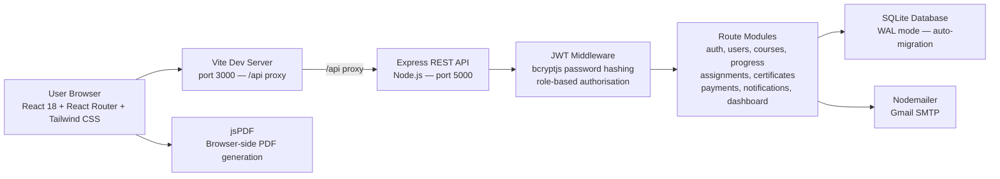
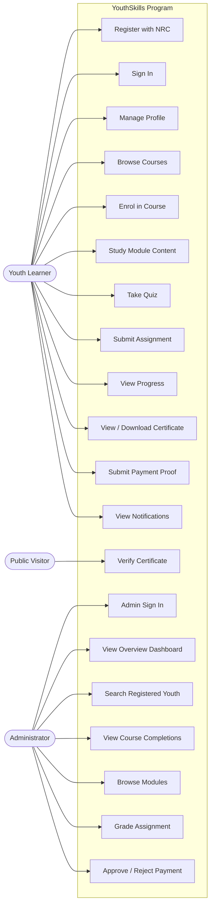
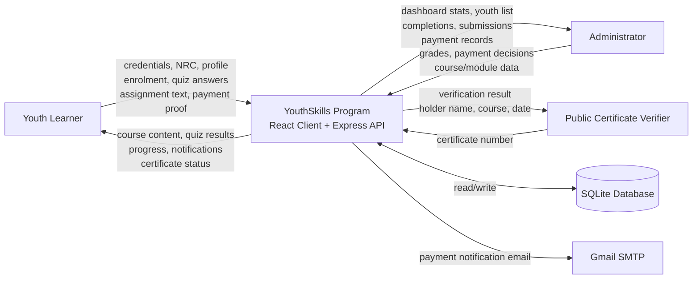
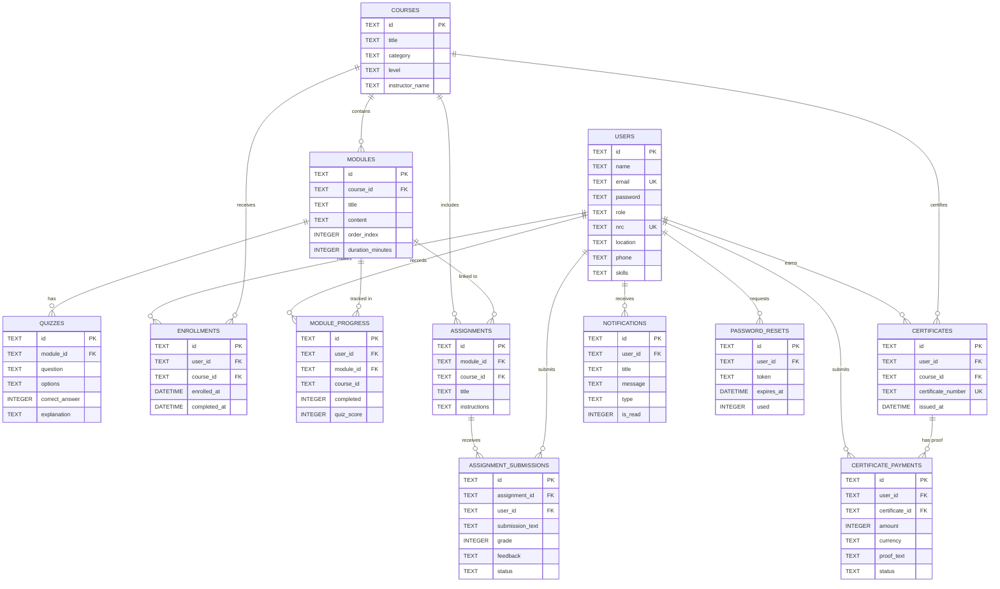
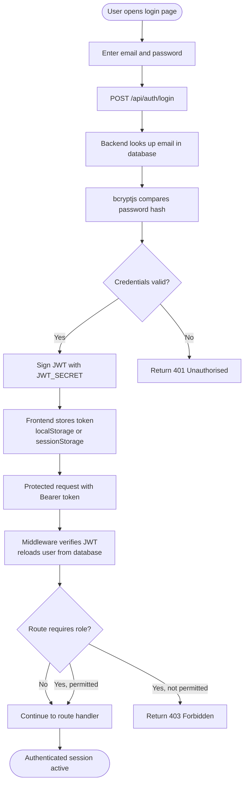
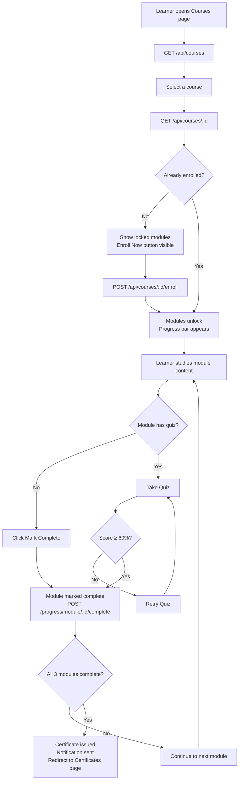
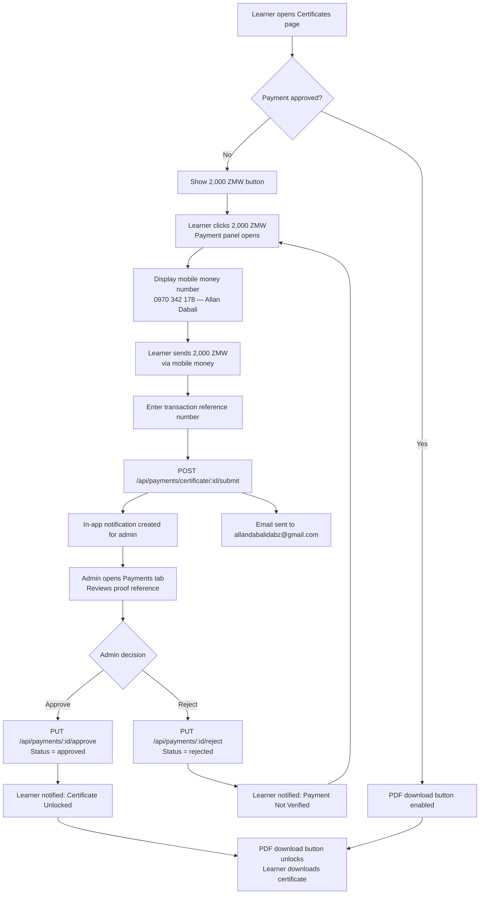
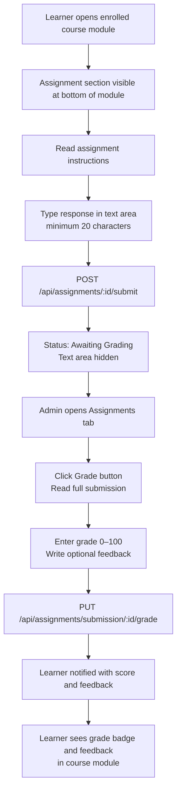

# YouthSkills Program — System Diagrams

**Version:** 2.0 — reflects the fully implemented system.  
These diagrams are written in Mermaid syntax. Render them in any Mermaid-compatible editor (e.g. mermaid.live) or import into a word processor for the final submission.

---

## Figure 3.1: System Architecture

---

## Figure 3.2: User Roles and Use Cases

---

## Figure 3.3: Level 0 Data Flow Diagram (Context Diagram)

---

## Figure 3.4: Entity-Relationship Diagram

---

## Figure 3.5: Authentication Flow

---

## Figure 3.6: Course Enrolment and Completion Flow

---

## Figure 3.7: Certificate Payment Flow

---

## Figure 3.8: Assignment Submission and Grading Flow

