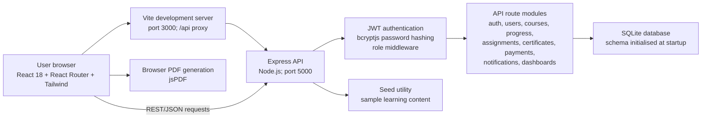
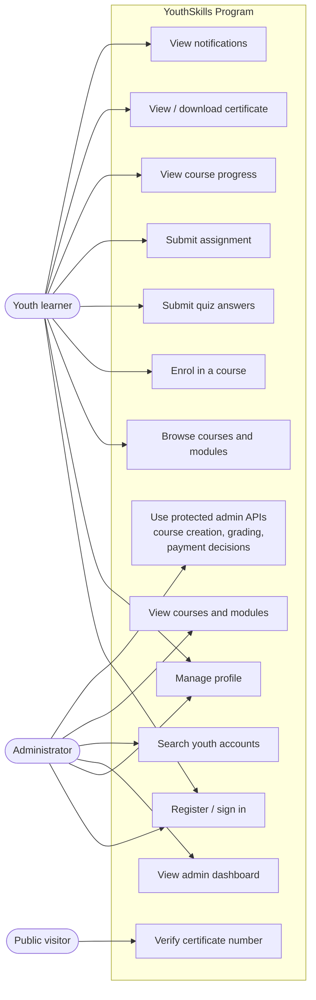
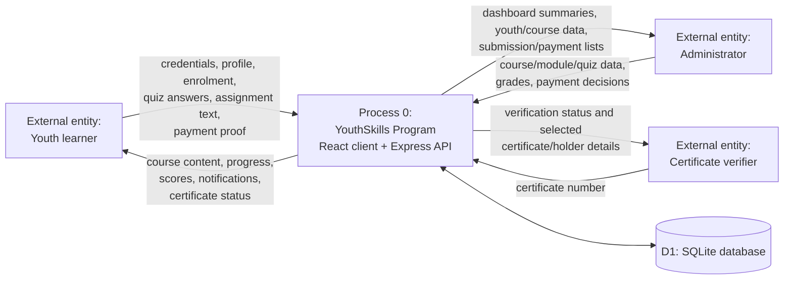
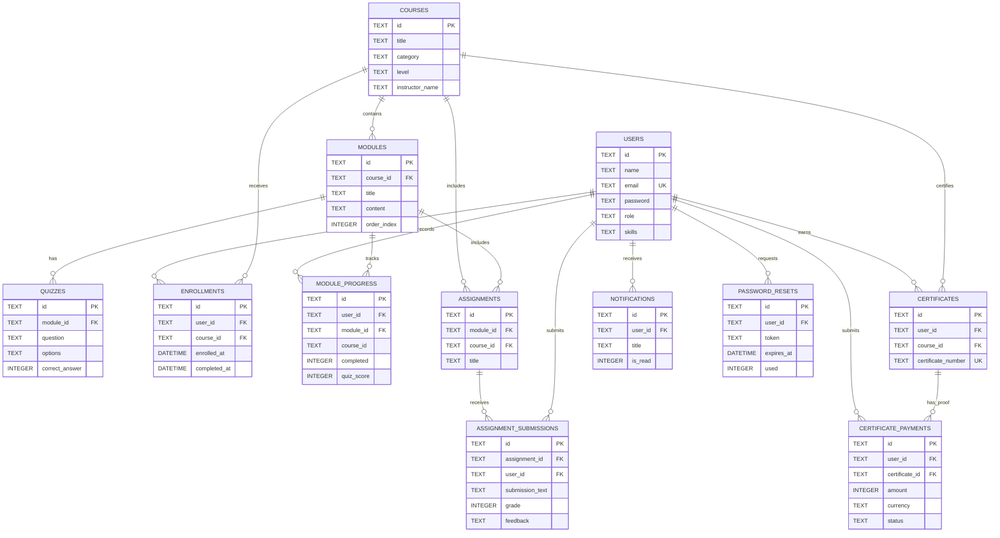
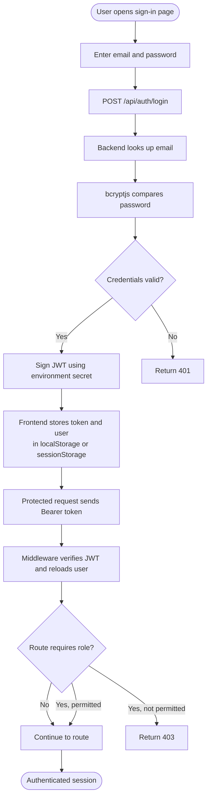
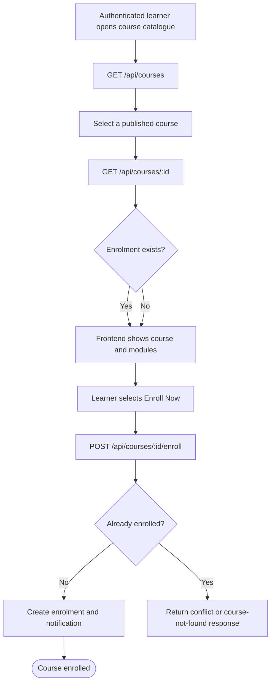
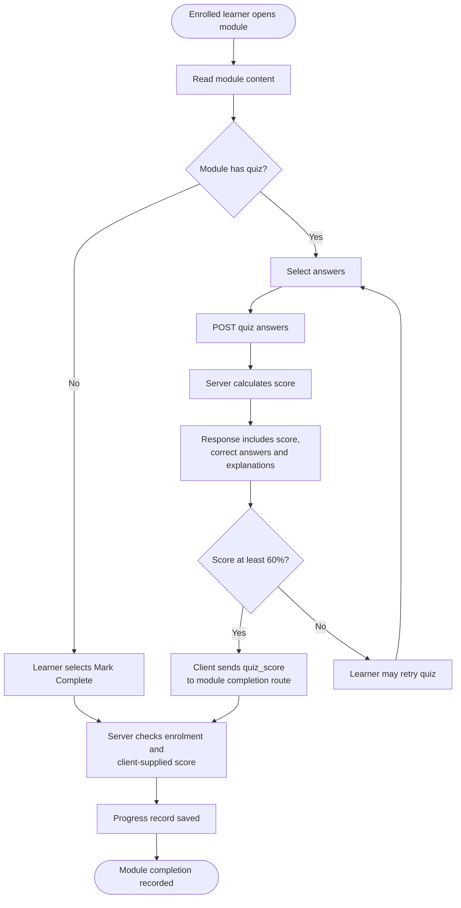
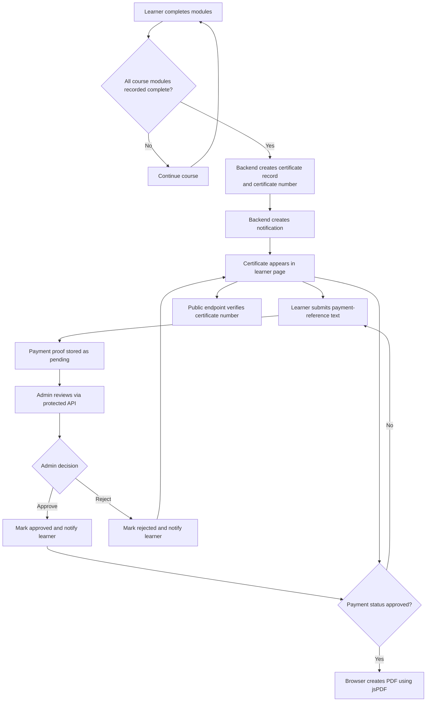

# YouthSkills Program — Editable System Diagrams

**Diagram status:** These Mermaid diagrams describe the current inspected implementation. They intentionally omit employment, opportunity, trainer and mentorship components because those features are not present in the current application. They can be rendered in Mermaid-compatible editors or documentation systems and redrawn for a final Word submission.

## Figure 3.1: Implemented high-level system architecture

## Figure 3.2: Implemented use-case overview

> The administrator use case includes API capabilities that are not all accessible through the current dashboard UI. The `employer` role is omitted because its UI is a placeholder and it has no active course or employment workflow.

## Figure 3.3: Level 0 data-flow diagram

## Figure 3.4: Entity-relationship overview based on actual tables

> The diagram shows declared foreign-key relationships. Some columns that logically refer to another table do not have declared foreign keys in the schema; see the technical documentation. Mermaid cardinalities do not replace the exact unique constraints documented in the schema.

## Figure 3.5: Authentication process

## Figure 3.6: Course enrolment and course-access workflow

> Access-control limitation: the frontend visually locks module interactions for a youth who is not enrolled, but the authenticated course-detail API returns module/quiz content without requiring an enrolment. This workflow diagram describes user-facing behaviour, not a guaranteed server-side content restriction.

## Figure 3.7: Assessment workflow as implemented

> Security limitation: the quiz response reveals correct answers, and the module-completion request accepts the client's score. The diagram documents this behaviour; it is not a recommended assessment design.

## Figure 3.8: Certificate generation and payment-proof workflow

> No electronic payment provider is integrated. Approval represents a manual status change. The inspected administrator interface does not include a payment-review screen; the decision is exposed as an admin API operation.
